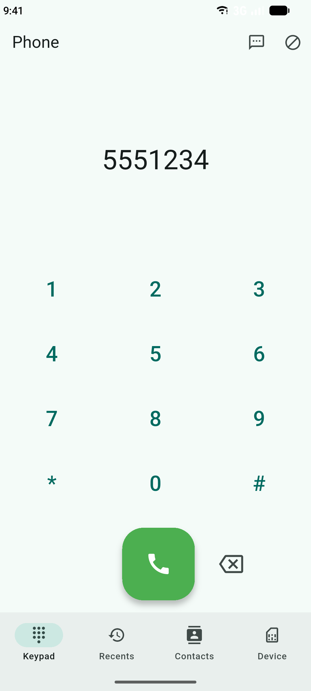
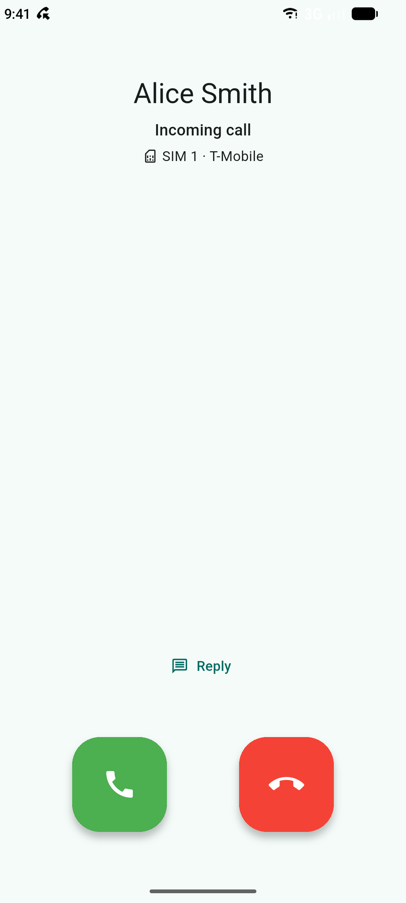
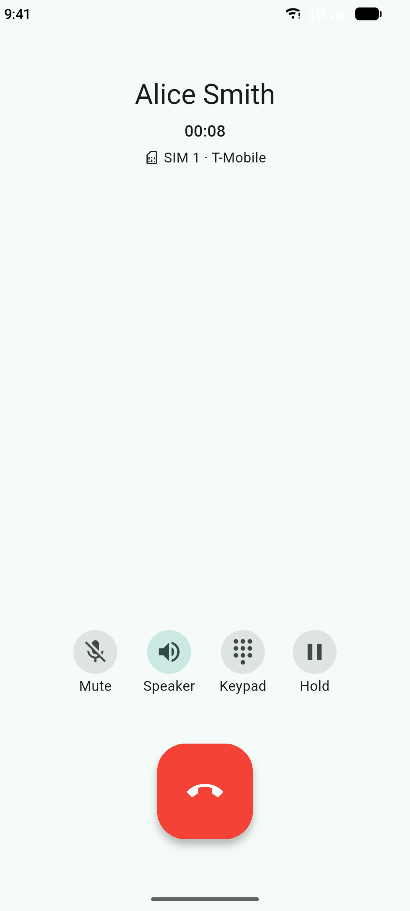
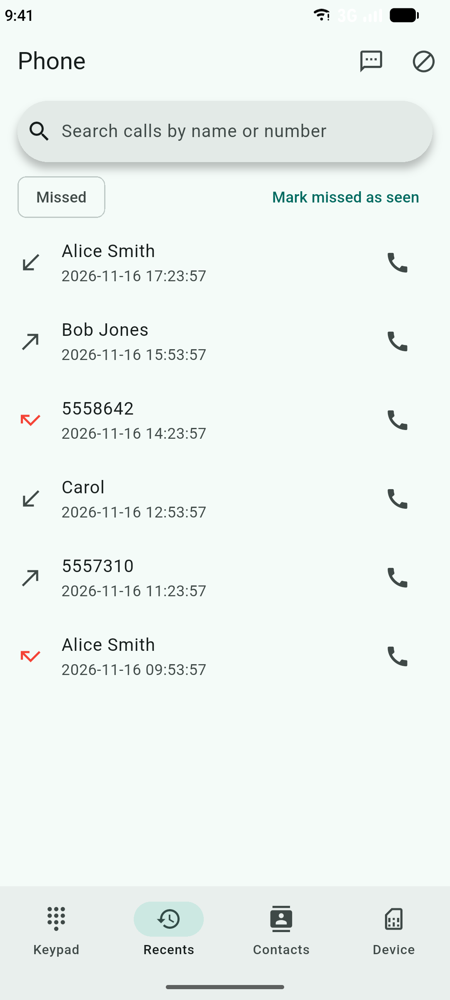

# telephony_kit

[](https://pub.dev/packages/telephony_kit)
[](https://github.com/mohamadElEaswy/telephony_kit/actions/workflows/ci.yaml)
[](LICENSE)

Build a complete **phone app** in Flutter on Android: place and control calls,
become the default dialer with your own in-call screen, block and screen
calls, search the call log and contacts, read SIM and live network info, run
USSD codes and send SMS.

- **No method channels.** Every API is a direct JNI call through bindings
  generated by [jnigen](https://pub.dev/packages/jnigen), so it is fast,
  synchronous where Android is, and fully typed.
- **A real dialer, not just `tel:` links.** Incoming call notifications that
  show over the lock screen, answer and decline, hold, keypad tones, mute,
  speaker and Bluetooth, swap and conference calls.
- **Call blocking that works when your app is closed.** Block numbers,
  prefixes, unknown or hidden callers, plus the system block list.
- **Ready for AI agents.** Ships an [agent skill](skills/telephony-kit/SKILL.md)
  and [AGENTS.md](AGENTS.md) so coding assistants use it correctly.

| Keypad | Incoming call | In call | Recents |
| :---: | :---: | :---: | :---: |
|  |  |  |  |

## Features

| Feature | Needs |
| --- | --- |
| Open the system dialer with a number | nothing |
| Place a call, choose the SIM, call voicemail | `CALL_PHONE` |
| Network, SIM and phone details, live signal and 2G to 5G events | `READ_PHONE_STATE` for some details |
| Call log and call log search | `READ_CALL_LOG` |
| Delete call log entries, mark missed calls seen, add entries | `WRITE_CALL_LOG` |
| Call log statistics and grouped rows, location, SIM and Wi-Fi/video/HD flags | `READ_CALL_LOG` |
| Full details of one call, the call history of a number or of a contact (all their numbers) | `READ_CALL_LOG` (+ `READ_CONTACTS` for contacts) |
| Call time and duration formatting, device time zone and 12/24-hour setting | nothing |
| Floating call bubble with call controls while the app is in the background | `SYSTEM_ALERT_WINDOW`, granted by the user in Settings |
| Contact search, caller lookup by number, every detail of a contact, paging through thousands of contacts | `READ_CONTACTS` |
| Add, edit, delete contacts and favorites, photos, groups, merge and split, vCard import and export, contact accounts | `WRITE_CONTACTS` |
| Watch for contact, call log and SMS changes | the matching read permission |
| Open the system contact screens | nothing |
| USSD codes such as `*100#` | `CALL_PHONE`, Android 8.0+ |
| Send SMS / search SMS, conversations, MMS (read), new SMS stream | `SEND_SMS` / `READ_SMS` |
| Delete SMS, mark read, default SMS role | the app is the default SMS app |
| Call forwarding and call waiting (through GSM codes) | `CALL_PHONE`, Android 8.0+ |
| Phone numbers of the SIMs, mobile data and roaming state, eSIM, signal in dBm, nearby cells | `READ_PHONE_NUMBERS`, `READ_PHONE_STATE`, `ACCESS_FINE_LOCATION` for cells |
| Default dialer and call screening roles | nothing |
| Call events, answer, reject (with a text), hang up, hold, DTMF, mute, audio routes and Bluetooth, swap, merge and conference, SIM choice, why a call ended, pause digits, proximity screen off, call and missed call notifications | the app is the default dialer and declares the in-call service |
| Emergency number check | nothing |
| Phone number formatting (as you type, national, international, E.164), comparing numbers, country of a number | nothing |
| Silence the ringer without rejecting the call | the app is the default dialer |
| Answer or end calls without being the default dialer | `ANSWER_PHONE_CALLS`, Android 8+ (end: 9+) |
| Per-contact ringtone and send to voicemail, list and preview ringtones | `READ_CONTACTS`, `WRITE_CONTACTS` to change |
| SIM inserted, removed or swapped events | `READ_PHONE_STATE` |
| Call screening with block rules | default dialer or call screening role, and the screening service declared |
| System block list | the app is the default dialer |

Android only (API 24+). iOS does not let third-party apps replace the phone
app or read call data, so it is not supported; on other platforms the APIs
throw.

## Install

```yaml
dependencies:
  telephony_kit: ^0.8.0
```

Minimum Android version is API 24 (Android 7.0).

## Quick start

```dart
import 'package:telephony_kit/telephony_kit.dart';

final telephony = TelephonyKit.instance;

// Open the dialer (no permission needed).
telephony.openDialer('+201234567890');

// Place a call directly (needs CALL_PHONE).
if (telephony.hasPermission(TelephonyPermission.callPhone)) {
  telephony.placeCall('+201234567890');
}

// Device and network.
final info = telephony.getNetworkInfo();
print('${info.networkOperatorName}, roaming: ${info.isRoaming}');
for (final sim in telephony.getSimCards()) {
  print(sim);
}

// Call log (needs READ_CALL_LOG).
for (final entry in telephony.getCallLog(limit: 20)) {
  print(entry);
}
```

### Search

```dart
// Call log: by name or number, call type and date. Runs in Android's
// provider, so only matching rows reach Dart.
final missedToday = telephony.searchCallLog(
  query: '0100',            // also matches +20100...
  types: {CallLogType.missed},
  from: DateTime.now().subtract(const Duration(days: 1)),
);

// Contacts with a phone number, by name or number (needs READ_CONTACTS).
for (final contact in telephony.searchContacts('ahm')) {
  print('${contact.displayName}: ${contact.phones}');
}

// Who is calling?
final caller = telephony.lookupNumber('+201001234567');
print(caller?.displayName ?? 'Unknown');
```

An empty query to `searchContacts` lists all contacts that have a number,
favorites first. Queries run synchronously on the calling isolate, which is
fast for normal address books; use `limit` to keep results small.

Errors from Android, such as a missing permission, are thrown as
`TelephonyException`.

### Contacts: read, add, edit and delete

`searchContacts` is a quick phone picker. For everything saved on a contact,
use `getContacts` and `getContact`, which return `ContactDetails` (name parts,
all phones, emails, addresses, company and job title, nickname, websites,
note, birthday, photo and favorite):

```dart
// All contacts with every detail, even those without a number.
// A query matches the name, an email, or a phone number in any format.
final all = telephony.getContacts(limit: 500);
final sara = telephony.getContacts(query: 'sara').first;
final same = telephony.getContact(sara.id); // null if it was deleted

// Add. Returns the new contact id.
final id = telephony.addContact(
  const ContactDetails(
    givenName: 'Sara',
    familyName: 'Ali',
    phones: [ContactPhone(number: '+20 100 123 4567', label: 'Mobile')],
    emails: [ContactEmail(address: 'sara@example.com', label: 'Work')],
    company: 'Acme',
    birthday: '1990-05-04',
  ),
);

// Edit: read, change with copyWith, save. Returns false if it was deleted.
final edited = telephony.getContact(id)!.copyWith(
  jobTitle: 'CTO',
  phones: [
    ...telephony.getContact(id)!.phones,
    const ContactPhone(number: '0222345678', label: 'Work'),
  ],
);
telephony.updateContact(edited);

telephony.setContactStarred(id, true); // favorite
telephony.deleteContact(id);           // cannot be undone
telephony.deleteContacts([id1, id2]);  // returns how many were deleted
```

Reading needs `READ_CONTACTS`; adding, editing, favoriting and deleting need
`WRITE_CONTACTS`. `updateContact` replaces the name, phones, emails,
addresses, company, nickname, websites, note and birthday with what you pass,
and leaves photos, groups and other data alone. `addContact` accepts
`accountType` and `accountName` to save into a synced account such as Google.
Contacts in a synced account are removed from the account when it next syncs.
Labels such as `Mobile`, `Home` and `Work` map to Android's types; any other
text becomes a custom label.

### Long contact lists: paging

`getContacts` returns at most `limit` contacts, which is fine for a picker but
not for a screen that lists all of them. For that, use `getContactsPage`. It
counts the matches natively and keeps only their ids, then loads the details
of one small page at a time, so 5,000 contacts scroll without freezing the UI
or filling memory:

```dart
var page = telephony.getContactsPage(query: 'sara', pageSize: 50);
print('${page.totalCount} contacts match');
show(page.contacts);

// When the list nears its end:
if (page.hasMore) {
  page = telephony.getContactsPage(
    query: 'sara',
    offset: page.nextOffset,
    pageSize: 50,
  );
  show(page.contacts);
}
```

Offset 0 rebuilds the id list, later offsets reuse it, so pages never skip or
repeat a contact while the user scrolls. Start again from offset 0 for a new
search, a pull to refresh, or when `contactChanges` fires. Debounce
search-as-you-type. The example app's Contacts tab is a complete
infinite-scroll list built this way.

### Permissions

telephony_kit checks permissions but does not request them, because asking
needs an activity result callback. Request them with a package such as
[permission_handler](https://pub.dev/packages/permission_handler), and declare
the ones you use in `android/app/src/main/AndroidManifest.xml`:

```xml
<uses-permission android:name="android.permission.CALL_PHONE" />
<uses-permission android:name="android.permission.READ_PHONE_STATE" />
<uses-permission android:name="android.permission.READ_CALL_LOG" />
<uses-permission android:name="android.permission.READ_CONTACTS" />
<!-- Only to add, edit or delete contacts -->
<uses-permission android:name="android.permission.WRITE_CONTACTS" />
<!-- Only to answer or end calls without being the default dialer -->
<uses-permission android:name="android.permission.ANSWER_PHONE_CALLS" />
<!-- Only for SIM phone numbers and nearby cells -->
<uses-permission android:name="android.permission.READ_PHONE_NUMBERS" />
<uses-permission android:name="android.permission.ACCESS_FINE_LOCATION" />
```

## Building a dialer app

To receive calls and show your own in-call screen, the app must be the
**default dialer**. That needs three things.

**1. An activity that handles `DIAL`.** Add these intent filters to your main
activity:

```xml
<intent-filter>
    <action android:name="android.intent.action.DIAL" />
    <category android:name="android.intent.category.DEFAULT" />
</intent-filter>
<intent-filter>
    <action android:name="android.intent.action.DIAL" />
    <category android:name="android.intent.category.DEFAULT" />
    <data android:scheme="tel" />
</intent-filter>
```

Adding `android:showWhenLocked="true"` and `android:turnScreenOn="true"` to the
activity lets the incoming call screen show over the lock screen.

Once the app is the default dialer, tapping a phone number anywhere (and
`openDialer`) opens your activity with a `tel:` uri. Read it with
`takeDialNumber()` when the app starts and resumes, and show it on your keypad.
For that, turn off Flutter deep linking in the activity, or Flutter tries to
open the number as a route:

```xml
<meta-data
    android:name="flutter_deeplinking_enabled"
    android:value="false" />
```

and keep the latest intent in `MainActivity`:

```java
@Override
protected void onNewIntent(@NonNull Intent intent) {
  super.onNewIntent(intent);
  setIntent(intent);
}
```

**2. The in-call service.** Declare the service that ships with the package
inside `<application>`:

```xml
<service
    android:name="dev.telephonykit.telephony_kit.TelephonyKitInCallService"
    android:permission="android.permission.BIND_INCALL_SERVICE"
    android:exported="true">
    <meta-data
        android:name="android.telecom.IN_CALL_SERVICE_UI"
        android:value="true" />
    <!-- false lets the system play the ringtone. -->
    <meta-data
        android:name="android.telecom.IN_CALL_SERVICE_RINGING"
        android:value="false" />
    <intent-filter>
        <action android:name="android.telecom.InCallService" />
    </intent-filter>
</service>
```

The package does not declare it for you, so apps that only use the other APIs
are not registered as an in-call UI.

**3. Ask the user for the role.**

```dart
if (!telephony.isDefaultDialer) {
  telephony.requestDefaultDialer(); // Shows the system prompt.
}
// Check isDefaultDialer again when the app resumes.
```

Then listen for calls:

```dart
telephony.callEvents.listen((event) {
  switch (event) {
    case CallAdded(:final callId):
      final call = telephony.call(callId);
      print('${call.isIncoming ? 'Incoming' : 'Outgoing'}: ${call.number}');
    case CallStateChanged(:final callId, :final state):
      print('$callId is now $state');
    case CallDisconnected(:final callId, :final cause):
      print('$callId ended: ${cause.displayText}');   // "Busy", "Call failed" ...
    case CallRemoved(:final callId):
      print('$callId removed');
    case PostDialWait(:final callId, :final remaining):
      telephony.call(callId).continuePostDial(true); // send "$remaining"
    case AudioStateChanged(:final muted, :final route):
      print('muted: $muted, route: $route');
  }
});

final call = telephony.calls.first;
call.answer();      // or reject(), hangUp(), hold(), unhold()
call.playDtmf('5');
call.stopDtmf();
telephony.setMuted(true);
telephony.setSpeakerOn(true);
```

### Call notifications

While the app is the default dialer, telephony_kit shows:

- an **incoming call** notification with Answer and Decline buttons. It opens
  your app full screen on the lock screen, and on Android 12+ it uses the
  system call style.
- an **ongoing call** notification with a timer and a Hang up button.

Add these permissions so they can show:

```xml
<uses-permission android:name="android.permission.POST_NOTIFICATIONS" />
<uses-permission android:name="android.permission.USE_FULL_SCREEN_INTENT" />
```

On Android 13+ also request `POST_NOTIFICATIONS` at runtime. Turn them off
with `telephony.showCallNotifications = false` if you build your own. When a
call starts ringing the service also tries to open your launcher activity;
turn that off with `telephony.launchAppOnIncomingCall = false`.

### Opening the call screen from the notification

Answer on the notification answers the call **and** opens your app, and so
does tapping the notification body. (Since Android 12 a notification button
may not open an app from a broadcast receiver, so the package uses a small
invisible activity, declared in its own manifest, that answers and then
brings your launcher activity to the front.)

Your app then needs to show the call. If your call screen is a route,
listen for the request:

```dart
telephony.callEvents.listen((event) {
  if (event is CallScreenRequested) openCallScreen(event.callId); // '' = current call
});

// The tap can also start the app, before you listen. Check at startup and
// on resume (like takeDialNumber):
final callId = telephony.takeCallScreenRequest();
if (callId != null) openCallScreen(callId);
```

To show the call over the lock screen, give your activity
`android:showWhenLocked="true"` and `android:turnScreenOn="true"`, and keep
`android:launchMode="singleTop"` so the existing screen is reused.

### Floating call bubble

When the user leaves your app during a call (home button, another app), a
small round bubble can float over other apps. Tapping it opens a panel with
**Mute**, **Speaker**, **End** and **Open** (back to your call screen);
while a call rings it shows **Answer** and **Decline**. The bubble can be
dragged, snaps to the nearest edge, remembers its place, and hides when your
app comes back or the call ends.

It needs the "display over other apps" permission. Declare it:

```xml
<uses-permission android:name="android.permission.SYSTEM_ALERT_WINDOW" />
```

Android has no permission dialog for it: the user switches it on in
Settings. A typical flow:

```dart
final bubble = telephony.callBubble;

Future<void> enableBubble() async {
  if (bubble.hasPermission) {
    bubble.enabled = true;
    return;
  }
  // Explain first, then send the user to Settings > Display over other apps.
  bubble.requestPermission();
  // In didChangeAppLifecycleState(resumed):
  //   if (bubble.hasPermission) bubble.enabled = true;
}

bubble.labels = const CallBubbleLabels(mute: 'كتم', end: 'إنهاء'); // translate
```

`enabled` is saved on the device, so the bubble also works when Flutter is
not running. Some phones (Xiaomi, Realme/ColorOS, Huawei) add their own
"floating window" switch; if the bubble does not appear after granting the
permission, check that one too. Android Go devices do not allow overlays.

### Choosing the SIM (dual SIM)

When the phone has no default SIM for calls, an outgoing call waits in
`CallState.selectPhoneAccount` until your app picks one:

```dart
if (call.state == CallState.selectPhoneAccount) {
  final options = call.selectablePhoneAccounts;   // PhoneAccount: id, label, slotIndex
  showPicker(options.map((a) => a.displayName));  // "SIM 1 · Vodafone"
  call.selectPhoneAccount(options.first.id, setDefault: false);
}
print(call.phoneAccount?.displayName);            // the SIM this call uses
```

`getPhoneAccountDetails()` lists every calling account with its label and
slot, for your own SIM selector before dialing.

### Rejecting with a message

```dart
call.reject(message: "Can't talk now, I'll call you back.");
print(call.cannedTextResponses);  // the user's replies from phone settings
print(telephony.quickReplies);    // package defaults, which you can replace
```

Android sends the text itself, so no SMS permission is needed.

### Why a call ended, pause digits and emergency numbers

- `call.disconnectCause` (also in the `CallDisconnected` event) has a `code`
  (`DisconnectCode.busy`, `rejected`, `error` ...), Android's `label` and
  `description`, `displayText` for the UI and `isFailure`. It stays readable
  for the last 20 calls.
- A `;` in a dialed number (for example `0223456789;1234`) sends a
  `PostDialWait` event; answer with `call.continuePostDial(true)`. A `,`
  pauses and continues by itself.
- `telephony.isEmergencyNumber('112')` checks the local emergency list.
  Call screening never blocks or silences emergency numbers.

### Silencing the ringer

`telephony.silenceRinger()` stops the ringtone and vibration of the ringing
call, like pressing a volume key, without rejecting it. The call keeps
ringing on screen and can still be answered or declined. Only the default
dialer may do this; it returns false otherwise.

```dart
TextButton(onPressed: telephony.silenceRinger, child: const Text('Silence'))
```

### Proximity sensor

During a call on the earpiece the package keeps a proximity wake lock, so
the screen turns off near the ear and your cheek cannot press buttons. It is
released on speaker, Bluetooth, while ringing and after the call. Turn it off
with `telephony.proximitySensorEnabled = false`.

### Missed call notifications

As the default dialer, Android asks your app to show missed call
notifications. Declare the receiver inside `<application>`:

```xml
<receiver
    android:name="dev.telephonykit.telephony_kit.TelephonyKitMissedCallReceiver"
    android:permission="android.permission.MODIFY_PHONE_STATE"
    android:exported="true">
    <intent-filter>
        <action android:name="android.telecom.action.SHOW_MISSED_CALLS_NOTIFICATION" />
    </intent-filter>
</receiver>
```

The `MODIFY_PHONE_STATE` permission means only the system phone service can
trigger it. The notification shows the count and last caller with a Call
back button. `markMissedCallsRead()` and `clearMissedCallNotification()`
clear it, and `missedCallNotificationsEnabled = false` turns it off.

### Several calls and conferences

```dart
telephony.swapCalls();                 // call waiting: hold one, resume the other
final call = telephony.calls.first;
if (call.canMerge) call.merge();       // make a conference
for (final party in call.children) {   // parties in a conference
  print(party.number);
}
call.children.first.splitFromConference();
```

To add a call, place another call with `placeCall` while one is active.

### Audio routes and Bluetooth

```dart
print(telephony.supportedAudioRoutes);  // {earpiece, speaker, bluetooth}
telephony.setAudioRoute(AudioRoute.speaker);
for (final device in telephony.bluetoothDevices) {
  print('${device.name} active: ${device.isActive}');
}
telephony.selectBluetoothDevice(telephony.bluetoothDevices.first.address);
```

Bluetooth device names need `BLUETOOTH_CONNECT` on Android 12+.

## Call screening and blocking

telephony_kit has two block lists.

**The app's rules**, applied by `TelephonyKitCallScreeningService`. They are
saved on the device and work even when the app is closed:

```dart
final rules = telephony.screening;
rules.blockNumber('+201001234567');       // matches 01001234567 too
rules.blockPrefix('0900');                 // premium numbers
rules.unknownCallerAction = ScreeningAction.silence; // needs READ_CONTACTS
rules.hiddenNumberAction = ScreeningAction.reject;
rules.blockedAction = ScreeningAction.reject;       // the default

telephony.screenedCalls.listen((c) => print('${c.number}: ${c.reason}'));
```

Declare the service in your manifest:

```xml
<service
    android:name="dev.telephonykit.telephony_kit.TelephonyKitCallScreeningService"
    android:permission="android.permission.BIND_SCREENING_SERVICE"
    android:exported="true">
    <intent-filter>
        <action android:name="android.telecom.CallScreeningService" />
    </intent-filter>
</service>
```

Android uses it when the app is the default dialer. Other apps can ask for the
call screening role with `requestCallScreeningRole()` (Android 10+).
Silencing needs Android 10+.

**The system block list** (`BlockedNumberContract`) is shared with the phone
and the SMS app, but only the default dialer may change it:

```dart
if (telephony.canBlockNumbers) {
  telephony.blockNumber('+201001234567');
  print(telephony.getBlockedNumbers());
  telephony.unblockNumber('+201001234567');
}
```

## Network, signal, voicemail and USSD

```dart
telephony.networkEvents.listen((event) {
  switch (event) {
    case SignalStrengthChanged(:final level):   // 0 to 4
      print('signal $level');
    case NetworkTypeChanged():
      print(event.generation.label);           // 2G, 3G, 4G, 5G
    case ServiceStatusChanged(:final status):
      print(status);
    case DeviceCallStateChanged(:final state):  // needs READ_PHONE_STATE
      print(state);
  }
});

print(telephony.signalLevel);
print(telephony.voicemailNumber);
telephony.callVoicemail();

final reply = await telephony.sendUssd('*100#');           // balance
final reply2 = await telephony.sendUssd('*100#', subscriptionId: 2);
```

USSD codes that open a multi-step menu only return the first screen.

### SIM inserted, removed or swapped

```dart
telephony.simChanges.listen((event) {          // needs READ_PHONE_STATE
  switch (event) {
    case SimInserted(:final sim):
      print('New SIM in slot ${sim.slotIndex + 1}: ${sim.displayName}');
    case SimRemoved(:final sim):
      print('${sim.displayName} removed');
    case SimChanged(:final before, :final after):
      print('${before.displayName} replaced by ${after.displayName}');
  }
});
```

The stream reports changes after it starts; read `getSimCards()` for the
current SIMs. eSIM profiles turned on or off count too. Some phones restart
the radio when a SIM is inserted, so a removal can be followed by an
insertion of the same SIM.

## Answering and ending calls without the dialer role

Apps that are not the default dialer (car, headset, wearable or
accessibility apps) can answer the ringing call and end the current one
with the `ANSWER_PHONE_CALLS` permission:

```dart
if (telephony.hasPermission(TelephonyPermission.answerPhoneCalls)) {
  telephony.answerRingingCall();   // Android 8+; video: true for video calls
  telephony.endCurrentCall();      // Android 9+; declines a ringing call
}
```

Both return false without the permission or on older Android. Emergency
calls are never ended. Use `networkEvents` (`DeviceCallStateChanged`) to
know when a call rings. The default dialer should use `PhoneCall.answer`
and `PhoneCall.hangUp` instead.

## Call log changes

```dart
final missed = telephony.searchCallLog(types: {CallLogType.missed});
telephony.deleteCallLogEntries(missed.map((e) => e.id));
telephony.deleteCallLogForNumber('01001234567');
telephony.markMissedCallsRead();   // clears the missed call badge
```

These need `WRITE_CALL_LOG`.

## SMS

```dart
final parts = await telephony.sendSms('+201001234567', 'Hello');
final found = telephony.searchSms(query: 'code', type: SmsType.inbox);
```

`sendSms` completes when every part was sent (not delivered). Google Play
only allows `SEND_SMS` and `READ_SMS` for the default SMS app and a few
listed exceptions, so leave them out unless your app qualifies.

### Google Play policy

Google Play only allows the call log, SMS and some phone permissions for apps
whose core purpose is to be the default phone (or SMS) app, and it asks you to
declare that in the Play Console. Only declare the permissions for the features
you use. Read the
[SMS and Call Log permissions policy](https://support.google.com/googleplay/android-developer/answer/10208820)
before you publish.

## Contacts in depth

### Ringtone and send to voicemail per contact

```dart
final settings = telephony.getContactCallSettings(contactId);
print(settings?.ringtoneTitle);            // empty for the default ringtone

final ringtones = telephony.getRingtones();  // title + uri, like the system picker
telephony.playRingtonePreview(ringtones.first.uri);
telephony.stopRingtonePreview();

telephony.setContactRingtone(contactId, ringtones.first.uri); // null = default
telephony.setContactSendToVoicemail(contactId, true);         // never rings
```

Android applies both itself when the contact calls, also while your app is
the default dialer. Changing them needs `WRITE_CONTACTS`.

### More contact fields

Contacts also hold IM handles, relatives and SIP addresses
(`ContactDetails.ims`, `relations`, `sipAddresses`), and these are saved by
`addContact` and `updateContact` like the other fields.

```dart
// Photos (encoded JPEG/PNG bytes).
final bytes = telephony.getContactPhoto(id, fullSize: true); // Uint8List?
telephony.setContactPhoto(id, jpegBytes);  // null removes it

// Accounts and groups (labels).
final accounts = telephony.getContactAccounts();      // Google, SIM, device
final groupId = telephony.addContactGroup('Family');  // or pass accountType/accountName
telephony.addContactToGroup(contactId, groupId);
telephony.removeContactFromGroup(contactId, groupId);
final members = telephony.getGroupMembers(groupId);
telephony.renameContactGroup(groupId, 'Close family');
telephony.deleteContactGroup(groupId);                // contacts are kept
for (final g in telephony.getContactGroups()) print('${g.title}: ${g.memberCount}');

// Duplicates: merge them (data is kept) or split them again.
for (final group in telephony.findDuplicateContacts()) {
  telephony.mergeContacts(group.map((c) => c.id));
}
telephony.splitContact(mergedId);

// vCard (.vcf) text: share it, save it, or import it.
final vcf = telephony.exportContactsAsVCard();
final newIds = telephony.importVCard(vcf);
// Pure Dart versions, no permissions: exportVCard(contacts), parseVCard(text).

// Android's own contact screens (no permission needed for the new contact one).
telephony.showContact(id);
telephony.openContactEditor(id);
telephony.openNewContactScreen(name: 'Sara', phone: '+201001234567');

// Refresh your list when anything changes, here or in another app.
telephony.contactChanges.listen((_) => reload());
```

`vCard` import reads versions 2.1, 3.0 and 4.0. Photos are not part of the
vCard text. Merging and splitting use Android's aggregation rules, so a
contact that Android re-merges on its own may need `splitContact` again.

## Call details and call history

```dart
// One call with every detail: formatted number and its label, post dial
// digits, presentation (hidden caller), voicemail, block reason, screening app.
final entry = telephony.getCallLogEntry(id);

// Every call with a number, in any format (0100 123 4567 = +20 100 123 4567).
final history = telephony.getCallHistory('+201001234567');

// Every call with a contact, across all of their numbers.
final sara = telephony.getContactCallHistory(contactId);
print('${sara.total} calls, ${sara.missed} missed, '
    'talk time ${sara.totalDuration}, last ${sara.lastCall?.date}');
sara.entriesFor('+201001234567');   // calls with one of the numbers

// Long lists stay fast without details; add them when you need them.
telephony.searchCallLog(query: 'sara', details: true);
```

`CallLogEntry` also has `displayName`, `displayNumber`, `endTime` and
`wasConnected`. `CallHistory.from(entries, numbers)` builds a history from
entries you already have.

## Dates, times and time zones

Call log times are stored by Android as UTC instants. telephony_kit returns
them as local `DateTime`s, so a call shows the right local time after the
user travels or the clocks change. `CallTimeFormatter` formats them the way
phone apps do, with no extra dependency:

```dart
final f = telephony.timeFormatter;   // follows the phone's 12/24h setting

f.relative(entry.date);              // 14:05 · Yesterday · Monday · 12 Nov
f.relative(entry.date, ago: true);   // Just now · 5 min ago · ...
f.day(entry.date);                   // Today · Yesterday · Monday · 12 Nov 2025
f.dateTime(entry.date);              // Today, 14:05
f.full(entry.date);                  // Wednesday, 12 November 2025, 14:05:09 GMT+02:00
f.duration(entry.duration);          // 2:05 (live call timers too)
f.durationWords(entry.duration);     // 2 min 5 s

// Section headers for a list, split at local midnight.
for (final day in groupByDay(entries, (e) => e.date, formatter: f)) {
  print('${f.day(day.key)}: ${day.value.length} calls');
}

final zone = telephony.timeZone;      // Africa/Cairo, Eastern European Time, +02:00
telephony.uses24HourFormat;           // the phone setting
```

For other languages pass `CallTimeLabels` (month and weekday names, Today,
Yesterday, units). `CallTimeFormatter(utcOffset: ...)` shows times at a
fixed offset instead of the device zone, which also makes tests
deterministic.

## Phone number formatting

Formatting uses Android's own `PhoneNumberUtils` (libphonenumber inside the
platform), so there is no extra dependency and numbers look the same as in
the system dialer. Every method takes an optional `countryIso` for numbers
dialled without a `+` code; it defaults to `telephony.defaultCountryIso`
(the mobile network's country, then the SIM's, then the system locale).

```dart
telephony.defaultCountryIso;                       // EG
telephony.formatPhoneNumber('01001234567');         // 010 01234567
telephony.formatPhoneNumber('+442079460000');       // +44 20 7946 0000
telephony.phoneNumberToE164('0100 123 4567');       // +201001234567 (null if invalid)
telephony.formatPhoneNumberAsYouType('+4420794');   // +44 20 794
telephony.normalizePhoneNumber('+1 (800) FLOWERS'); // +18003569377
telephony.isSamePhoneNumber('01001234567', '+20 100 123 4567'); // true

final country = telephony.phoneNumberCountry('+447911123456');
print('${country?.flag} ${country?.isoCode} +${country?.callingCode}'); // 🇬🇧 GB +44
```

For a text field, add `PhoneNumberInputFormatter`. It formats while typing,
keeps the cursor after the same digit, and deleting a space deletes the
digit before it:

```dart
TextField(
  keyboardType: TextInputType.phone,
  inputFormatters: [PhoneNumberInputFormatter()],
)
```

`formatPhoneNumber` returns the input unchanged when it is not a number
(USSD codes, short codes, partial input). Store numbers as E.164 and
format them only for display.

Pure Dart helpers that need no device: `callingCodeOf('+20 100...')`,
`countryOfNumber(e164)` (North American numbers are told apart by area code,
so `+1 416...` is `CA`), `regionsForCallingCode(44)` and
`callingCodeForRegion('EG')`.

## Call log extras

```dart
// Each entry also has geocodedLocation, subscriptionId, countryIso, isRead
// and the flags hasVideo, isWifi, isHd, isRtt.
final stats = telephony.getCallLogStats(from: DateTime(2026, 1, 1));
print('${stats.first.number}: ${stats.first.total} calls, '
    '${stats.first.missed} missed, ${stats.first.totalDuration}');

// "Sara (3)" rows: consecutive calls to one number joined.
final rows = telephony.getGroupedCallLog();

// Pure Dart on a list you already have: callLogStats(entries), groupCallLog(entries).

telephony.addCallLogEntry(number: '+201001234567', type: CallLogType.outgoing,
    duration: const Duration(minutes: 2));       // WRITE_CALL_LOG
telephony.callLogChanges.listen((_) => reload()); // READ_CALL_LOG
```

## SMS and MMS in depth

```dart
final threads = telephony.getSmsThreads();                 // newest first
final messages = telephony.searchSms(threadId: threads.first.threadId);

// New messages as they arrive (watches the inbox; no receiver needed).
telephony.incomingSms.listen((m) => print('${m.address}: ${m.body}'));
telephony.smsChanges.listen((_) => reload());              // any change

// MMS is read only: text, subject, addresses and attachment URIs.
for (final mms in telephony.getMmsMessages(limit: 20)) {
  print('${mms.addresses}: ${mms.text} ${mms.parts.where((p) => p.isImage)}');
}

// Changing messages is only allowed for the default SMS app.
if (!telephony.isDefaultSmsApp) telephony.requestDefaultSmsApp();
telephony.markSmsThreadRead(threadId);
telephony.deleteSmsMessages([message.id]);
telephony.deleteSmsThread(threadId);
```

`requestDefaultSmsApp` shows the system prompt, but Android only offers apps
that declare the components a default SMS app must have: a receiver for
`SMS_DELIVER` (permission `BROADCAST_SMS`), one for `WAP_PUSH_DELIVER`
(`BROADCAST_WAP_PUSH`), an activity for `SENDTO` on `sms:`/`smsto:`/`mms:`/
`mmsto:`, and a service for `RESPOND_VIA_MESSAGE` (`SEND_RESPOND_VIA_MESSAGE`).
telephony_kit does not ship these, because a default SMS app must store the
messages it receives; your app provides them. Sending MMS is not supported.
`defaultSmsPackage` can be null on devices where Android does not report one;
use `isDefaultSmsApp` to check your own role.

## Video, caller verification, Wi-Fi calling, RTT and forwarding

On a call (default dialer only):

```dart
telephony.placeCall('+201001234567', video: true);   // starts a video call
call.videoState; call.isVideo;                       // 0 audio, 1 TX, 2 RX, 3 both
call.answerWithVideo();                              // instead of call.answer()

switch (call.numberVerification) {                   // STIR/SHAKEN, Android 11+
  case NumberVerification.failed: showSpoofWarning();
  case NumberVerification.passed: showVerifiedBadge();
  default: break;
}
call.isWifiCall;  call.isHdAudio;                    // Wi-Fi calling, HD voice

// Real-time text (Android 9+, needs carrier support).
call.requestRtt();                                   // then watch call.isRttActive
if (call.pendingRttRequestId != null) call.respondToRtt(accept: true);
call.sendRttText('hello');  call.readRttText();      // poll on a short timer
call.stopRtt();
```

The package reports video state and lets you start and answer video calls, but
it does not draw camera or remote video frames. RTT and video changes arrive
as `CallStateChanged` events; re-read the call when one comes.

Call forwarding and call waiting use the standard GSM codes through
`sendUssd`, so they work on most carriers and need no privileged permission:

```dart
await telephony.setCallForwarding(CallForwardingCondition.noReply, '+201001234567');
final reply = await telephony.queryCallForwarding(CallForwardingCondition.busy);
await telephony.cancelCallForwarding(CallForwardingCondition.unconditional);

await telephony.setCallWaiting(true);
await telephony.queryCallWaiting();   // the carrier's own wording
```

Whether a call is on Wi-Fi is per call (`PhoneCall.isWifiCall`,
`CallLogEntry.isWifi`). Android gives third-party apps no setting to read
whether Wi-Fi calling is switched on.

## Device details

```dart
for (final n in telephony.getPhoneNumbers()) print('slot ${n.slotIndex}: ${n.number}');
print(telephony.signalDbm);                 // about -50 excellent, -110 poor
for (final c in telephony.getCellInfo()) print('${c.type} ${c.dbm} dBm');
print(telephony.isMobileDataEnabled);
print(telephony.isDataRoamingAllowed);      // the user setting; getNetworkInfo() says if roaming now
print(telephony.dataConnectionState);
final esim = telephony.getEsimInfo();       // isSupported, eid (carrier apps only), profiles
```

A SIM's own number is often empty because carriers do not store it. Cell
info needs location permission, and Android may return nothing when location
is off.

## Example

[`example/`](example) is a small dialer with a keypad (with SIM choice and
number formatting as you type), recent
calls grouped by day with search and a missed filter, a call details screen
with the full history of the number or contact, contacts with search,
recent calls, ringtone and send to voicemail, device details (time zone, call bubble switch), and an in-call
screen with answer, silence, reject, hang up, mute, speaker and hold.

```sh
cd example
flutter run
```

## How it works

```
Dart API (lib/src/telephony_kit_impl.dart)
   │  uses
   ▼
jnigen bindings (lib/src/bindings.g.dart)
   │  JNI
   ├──► Android framework: TelecomManager, TelephonyManager, RoleManager,
   │    SubscriptionManager, ContentResolver, CallLog ...
   └──► Package Java (android/src/main/java):
        CallManager ◄── TelephonyKitInCallService (bound by the system)
        CallScreening ◄── TelephonyKitCallScreeningService (bound by the system)
        CallNotifications, CallActionReceiver (notification buttons)
        CallActionActivity (answer and open the app from a notification)
        CallBubble (floating call controls over other apps)
        NetworkMonitor, UssdHelper, SmsHelper
        CallEventListener, ScreeningListener, NetworkEventListener,
        ResultListener (implemented in Dart)
```

Android only talks to services, receivers and abstract callback classes that
are real Java subclasses, which cannot be generated from Dart. Those are the
only Java code: the in-call and screening services, the notification button
receiver and its invisible activity, the floating call bubble (a window that
must work while Flutter is not running), and small helpers for callbacks Android only offers as abstract
classes (USSD, telephony callbacks, SMS results). jnigen generates Dart
bindings for the helpers, and Dart implements the listener interfaces
directly. Everything else calls the Android framework from Dart.

### Regenerating the bindings

The bindings are checked in. To regenerate them after changing the Java code
or the list of Android APIs in [`tool/jnigen.dart`](tool/jnigen.dart):

```sh
export ANDROID_SDK_ROOT=/path/to/android/sdk   # needs platforms/android-36 or 35
flutter pub get
dart run tool/jnigen.dart
```

`tool/jnigen.dart` keeps an allow list of the Android methods and fields the
package uses, so the generated file stays small.

## Using telephony_kit with AI coding agents

The package ships agent instructions inside the published package:

- [`skills/telephony-kit/SKILL.md`](skills/telephony-kit/SKILL.md) is a skill
  for agents building apps **with** telephony_kit: setup checklist, API map,
  patterns and pitfalls, with [manifest](skills/telephony-kit/references/manifest.md)
  and [API](skills/telephony-kit/references/api.md) references.
- [`AGENTS.md`](AGENTS.md) is for agents working **on** this repository: the
  jnigen-only rule, how to add Android APIs and regenerate bindings, and the
  checks to run.

To give Claude Code the skill in your app project, copy the folder into your
project's `.claude/skills/`:

```sh
mkdir -p .claude/skills
cp -r "$(ls -d ~/.pub-cache/hosted/pub.dev/telephony_kit-* | sort -V | tail -1)/skills/telephony-kit" \
  .claude/skills/
```

Other agents can be pointed at the same `SKILL.md` file, for example from
your project's `AGENTS.md`.

## License

MIT
